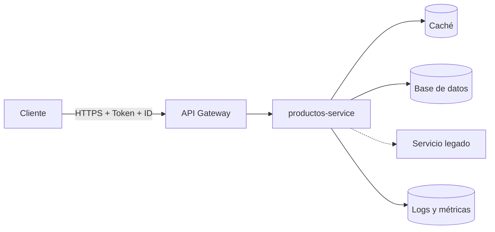

# Modelado de amenazas: `/api/v1/products/{id}`

## 1. Objetivo

Identificar los riesgos de seguridad durante la migración del endpoint `/api/v1/products/{id}` mediante:

- Un **diagrama de flujo de datos (DFD)**.
- La metodología de modelado de amenazas **STRIDE**.
- La identificación y priorización de los riesgos principales.
- La definición de mitigaciones y pruebas mínimas de seguridad.

---

## 2. Diagrama de flujo de datos (DFD)

### 2.1. Componentes del DFD

| Identificador | Componente | Tipo |
|---|---|---|
| `C` | Cliente | Entidad externa |
| `G` | API Gateway | Proceso |
| `P` | `productos-service` | Proceso |
| `CCH` | Caché | Almacén de datos |
| `DB` | Base de datos | Almacén de datos |
| `L` | Servicio legado | Entidad externa o proceso externo |
| `OBS` | Logs y métricas | Almacén de datos / sistema de observabilidad |

---

## 3. Elementos y amenazas STRIDE

| Elemento del DFD | Amenazas aplicables |
|---|---|
| Procesos | **S**, **T**, **R**, **I**, **D**, **E** |
| Almacenes de datos | **T**, **R**, **I**, **D** |
| Flujos de datos | **T**, **I**, **D** |
| Entidades externas | **S**, **R** |

### 3.1. Referencia de STRIDE

| Código | Categoría | Descripción |
|---|---|---|
| **S** | *Spoofing* | Suplantación de identidad. |
| **T** | *Tampering* | Manipulación no autorizada de datos o sistemas. |
| **R** | *Repudiation* | Negación de acciones realizadas sin evidencia suficiente para atribuirlas. |
| **I** | *Information Disclosure* | Divulgación o exposición no autorizada de información. |
| **D** | *Denial of Service* | Denegación o degradación de la disponibilidad del servicio. |
| **E** | *Elevation of Privilege* | Elevación de privilegios o acceso por encima de los permisos concedidos. |

---

## 4. Riesgos principales

| Riesgo | Categoría STRIDE | Nivel |
|---|---|---|
| Acceso a productos ajenos mediante la modificación de `{id}` | **E / I** | **Crítico** |
| Uso de un token inválido, robado o expirado | **S** | **Alto** |
| Inyección mediante el parámetro `{id}` | **T** | **Crítico** |
| Exposición de campos internos | **I** | **Alto** |
| Caché compartida entre usuarios | **T / I** | **Crítico** |
| Saturación mediante solicitudes masivas | **D** | **Alto** |
| Diferencias de autorización entre los sistemas nuevo y legado | **E** | **Crítico** |

---

## 5. Mitigaciones

1. Validar la **firma**, la **audiencia**, el **emisor** y la **expiración** del token.
2. Verificar los **roles**, los **scopes** y el acceso del usuario al producto solicitado.
3. Aplicar la autorización dentro de `productos-service`, sin depender exclusivamente del API Gateway.
4. Validar el formato, el tipo y la longitud del parámetro `{id}`.
5. Utilizar consultas parametrizadas y objetos de transferencia de datos (**DTOs**).
6. Separar la caché por organización, usuario y contexto de acceso cuando corresponda.
7. Implementar **TLS**, limitación de solicitudes (*rate limiting*), tiempos de espera (*timeouts*) y auditoría.
8. Evitar el registro de tokens, credenciales y datos sensibles.
9. Mantener reglas de autorización equivalentes entre `productos-service` y el servicio legado.
10. Aplicar una lista explícita de campos permitidos en las respuestas para evitar la exposición de atributos internos.

---

## 6. Pruebas mínimas de seguridad

| Escenario de prueba | Resultado esperado |
|---|---|
| Token ausente, inválido o expirado | `401 Unauthorized` |
| Scope insuficiente | `403 Forbidden` |
| Solicitud de un producto perteneciente a otro usuario u organización | `403 Forbidden` o `404 Not Found`, según la política definida |
| Identificador con formato o longitud inválidos | `400 Bad Request` |
| Producto inexistente | `404 Not Found` |
| Exceso de solicitudes | `429 Too Many Requests` |
| Error interno | Respuesta controlada, sin *stack traces* ni datos sensibles |
| Manipulación de `{id}` con caracteres de inyección | Solicitud rechazada y sin ejecución de instrucciones no autorizadas |
| Acceso repetido desde contextos de autorización distintos | La caché no entrega datos de otro usuario u organización |
| Diferencia de permisos entre el sistema nuevo y el legado | Acceso denegado de manera consistente y evento registrado para auditoría |

---

## 7. Recomendaciones de seguimiento

- Asignar a cada riesgo un propietario y una fecha objetivo de mitigación.
- Definir criterios homogéneos para los niveles **Crítico**, **Alto**, **Medio** y **Bajo**.
- Incorporar estas pruebas en la integración continua.
- Ejecutar pruebas de autorización para detectar referencias directas inseguras a objetos (**IDOR/BOLA**).
- Revisar periódicamente las claves de caché, las políticas de retención de logs y las reglas de enmascaramiento.
- Comparar el comportamiento de autorización del servicio nuevo con el sistema legado antes de completar la migración.
- Registrar evidencia de las pruebas y conservarla como parte del proceso de aceptación de seguridad.
